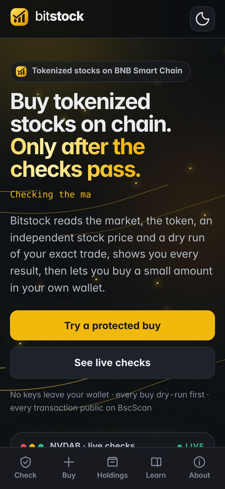
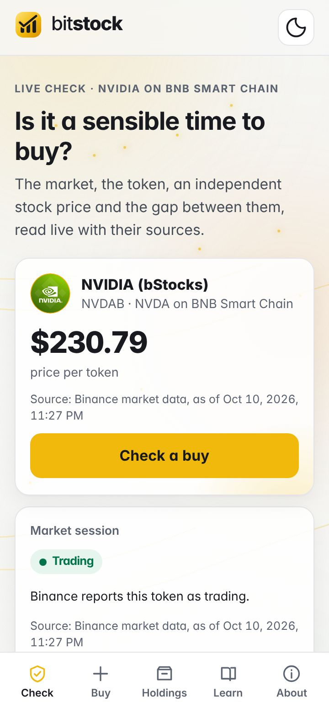
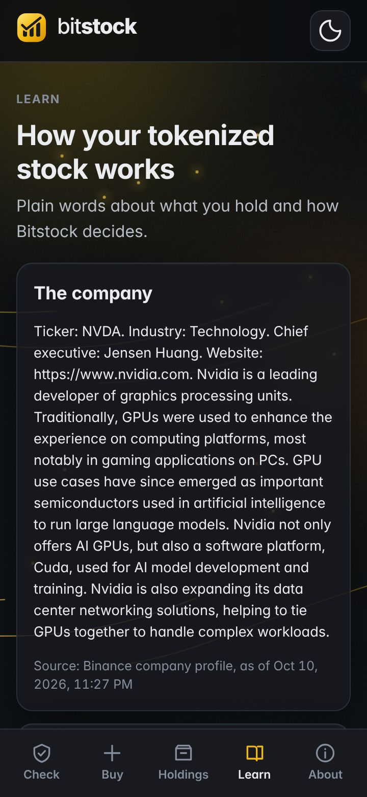

# Bitstock

**Buy tokenized stocks on BNB Smart Chain, only after the checks pass.**

Bitstock is a market-aware assistant for small-money investing in tokenized stocks. Before every buy it reads the market session, the token's share multiplier, an independent stock price, the price impact of your exact amount, and a dry run of the real transaction. It shows you each result with its source and time, decides **Go**, **Go with a tighter limit**, **Wait** or **Do not buy now**, and only then lets you sign a small buy in your own wallet. Afterwards it explains, in plain words, what you hold.

Built for BNB Hack: Tokenized Stocks Edition. BSC mainnet only. Spot only. Not investment advice.

| | |
|---|---|
| **Web app** | https://bitstock-lilac.vercel.app (also https://bitstock-algo-dao-30577dec.vercel.app and https://web-production-37d6.up.railway.app) |
| **Agent API** | https://agent-production-6403.up.railway.app/healthz (Railway, Singapore) |
| **Try it** | Open the web app on a phone. The live check and the explanations need no wallet. A buy needs a BNB Smart Chain wallet with a little USDT. |

<p>
  
  
  
</p>

## Proof on BSC mainnet

Every row is a real transaction or a real recorded response. Nothing here is simulated or sample data.

| What | Evidence |
|---|---|
| A real protected buy: 1 USDT bought **0.004333697515150079 NVDAB**, signed by the owner in their own wallet after the guard said LIMIT and the exact transaction passed its dry run. Gas used 939,279; fee 0.0000490773 BNB. | [0x526643d7…e8c1](https://bscscan.com/tx/0x526643d73ed93ad2a90033397710d4d03d41d6835938e722ba647b408666e8c1) (block 126,905,587, 10 Oct 2026 22:12 UTC) · [`docs/evidence/mode-a-buy-1usd.json`](docs/evidence/mode-a-buy-1usd.json) |
| The owner's USDT approval for the swap contract, capped at 2 USDT | [0x1a500450…d8be](https://bscscan.com/tx/0x1a500450deba945ebc1d2207d702e7db791293a424499213a4c78d7e7fd4d8be) |
| A guard decision on a Saturday, with the US market closed: LIMIT, with a slippage limit tightened from 0.5% to about 0.1% | [`docs/evidence/guard-nvdab-1usd-after-approval.railway-sg.json`](docs/evidence/guard-nvdab-1usd-after-approval.railway-sg.json) |
| The guard refusing to proceed before the approval existed: BLOCK, "approve first" | [`docs/evidence/guard-nvdab-1usd.railway-sg.json`](docs/evidence/guard-nvdab-1usd.railway-sg.json) |
| Signed Binance Web3 API calls from an allowed region, and the same call refused from a US connection (`40304`) | [`docs/evidence/`](docs/evidence/) · [`docs/VERIFIED.md`](docs/VERIFIED.md) section 3a |
| Live on-chain reads of NVDAB's ERC-8056 multiplier | [`docs/evidence/07-onchain-nvdab.json`](docs/evidence/07-onchain-nvdab.json) |
| The claim page refusing a request from the United States with HTTP 451 | Tested on the Vercel deployment from a US connection; see [`docs/screenshots/phone-claim-dark.jpg`](docs/screenshots/phone-claim-dark.jpg) |

## What it does

| | |
|---|---|
| **Check** | Five checks on live data before every buy: market session (Binance RWA Data), share multiplier (the token contract, ERC-8056 `uiMultiplier()`), an independent stock price (compared per share through the multiplier), price impact and route for your exact amount (only routes that can be dry-run), and a Transaction API dry run that must show the stock arriving in your wallet. |
| **Decide** | GO when everything passes; LIMIT when there are warnings, with a tighter slippage limit chosen by a written rule; WAIT when something cannot be read, re-checked later from scratch; BLOCK on any failure, with one sentence why. Missing data never becomes a guess. |
| **Buy** | The swap is rebuilt from the exact quote that was checked, pinned to the contract the quote named, dry-run again, and given a gas limit from the node's estimate. You sign it in your own wallet. Bitstock never holds keys. |
| **Explain** | Your tokens shown as shares, and what changes them. Bitstock says "dividend" only when the implied amount matches the company's announcement and every input is confirmed; otherwise it says "multiplier change" and lists what is and is not known. |

## Status

| Part | Status |
|---|---|
| Signed Binance Web3 API client (RWA Data, Trading, Transaction) | Built, used live |
| Guard: five checks, four outcomes, stored decision records, written method | Built, used live |
| Protected buy (Mode A): decision API, prepared and re-simulated transaction, signing page | Built; one real buy on mainnet |
| Chain package: unit conversions, EIP-155 signing, ERC-20 transfer with dry run, multiplier events | Built, tested |
| Explainer and multiplier sentry | Built; the sentry records snapshots on the server |
| Web app: home, live check, buy, holdings, learn, about, claim notice | Built, deployed |
| Restricted-jurisdiction block on the claim page | Built, tested from a US connection |
| Free first slice (gift with the network fee paid for the recipient) | **Not built** |
| Scheduled buys through the user's own Binance Agentic Wallet (Mode B wallet skill) | **Not built** |
| Agent on BNB Agent Studio | **Not built** |

## How it maps to the judging criteria

| Criterion | What to look at |
|---|---|
| Technical implementation | A deterministic guard with 169 tests, contract tests replaying recorded live responses, bigint money math with property tests, EIP-155 signing checked against the specification's test vector, a real buy whose prepared transaction is pinned and re-simulated, SQLite storage with idempotency keys, a persistent kill switch and reconciliation from receipts. |
| Creativity | The guard treats a weekend as a real condition: tokenized stocks trade on chain while Wall Street is shut, so it compares with the last close and only allows a tighter limit, instead of either blocking or ignoring it. |
| Developer experience | A timestamped friction log with evidence for each line: [`docs/DX_EVIDENCE.md`](docs/DX_EVIDENCE.md). The report itself is written by the owner. |
| Product quality | Phone-first, light and dark, keyboard and reduced-motion friendly. Lighthouse (mobile) on the Vercel deployment: performance 97 to 99, accessibility 100, best practices 100. |

## Risk controls

| Control | Default | Where |
|---|---|---|
| Price impact | warn above 0.3%, refuse above 1% | `packages/guard/src/config.ts` |
| Independent price gap | live price: pass within 0.5%, refuse above 2%; last close: never a pass, refuse above 10% | same |
| Slippage | 0.5% on GO; on LIMIT, twice the quoted impact plus 0.10%, kept between 0.10% and 0.25% | same, explained in [`docs/METHOD.md`](docs/METHOD.md) |
| Multiplier change | warn when one is scheduled within 24 hours | same |
| Routes | quote-on-request (RFQ) routes refused because they cannot be dry-run | `packages/guard/src/rules.ts` |
| Swap destination | refused unless it goes to the contract the quote named, from the buyer, with no BNB attached | same |
| Largest buy | $5 | `BUY_MAX_USD` |
| Kill switch | environment flag or authenticated admin call; survives restarts; cleared only with an explicit phrase | `apps/agent/src/killswitch.ts` |
| Rate limits | 10 checks per minute per client | `RATE_LIMIT_PER_MINUTE` |

The defaults are conservative starting values, not measured ones; `docs/METHOD.md` says so and how they will be revised.

## Binance Web3 API endpoints used

| Module | Endpoint | Purpose |
|---|---|---|
| RWA Data | `GET /api/v1/dex/market/rwa/tokens` | Token list, price, market status |
| RWA Data | `GET /api/v1/dex/market/rwa/underlying-market` | Market status (`statusInfo`) and market data |
| RWA Data | `GET /api/v1/dex/market/rwa/underlying-profile` | Ticker and company note |
| RWA Data | `GET /api/v1/dex/market/rwa/price` | Probed and recorded |
| Trading | `GET /api/v1/dex/aggregator/quote` | Live quote at the exact size |
| Trading | `GET /api/v1/dex/aggregator/swap` | The transaction to dry-run and sign |
| Trading | `GET /api/v1/dex/aggregator/approve-transaction` | Probed: approval order verified |
| Transaction | `POST /api/v1/dex/pre-transaction/simulate` | Dry run of every swap |

Also used: BNB Smart Chain JSON-RPC (multiplier, allowance, balances, gas estimates, receipts) and Yahoo Finance's chart API as the independent stock price (Pyth Pro is tried first when its key is entitled to US equities; see [`docs/VERIFIED.md`](docs/VERIFIED.md) section 6a).

## Run it

Requires Node 22.18 or later, pnpm, a Binance Web3 API key, and a server in a region the Binance Web3 API allows.

```bash
cp .env.example .env              # fill in values; never commit .env
pnpm install
pnpm lint && pnpm typecheck && pnpm test && pnpm build
PORT=8080 PUBLIC_WEB_ORIGIN=http://localhost:3000 node apps/agent/src/server.ts   # agent API on :8080
NEXT_PUBLIC_AGENT_URL=http://localhost:8080 pnpm --filter @bitstock/web dev          # web app on :3000
```

## Repository

```text
apps/agent       decision API, signing page, intent queue, sentry, admin
apps/web         the web app (Next.js)
packages/binance signed Web3 API client and by-shape finders
packages/guard   the five checks, the outcome rule, decision records
packages/chain   unit conversions, signing, ERC-20, multiplier events
packages/explainer multiplier math and plain-language text
docs/            architecture, decisions, method, verified facts, evidence
```

| | |
|---|---|
| `AGENTS.md` | Engineering manual and hard rules |
| `docs/ARCHITECTURE.md` | How the system is built and why |
| `docs/adr/` | Architecture decisions |
| `docs/METHOD.md` | How the guard decides, with every default and its reason |
| `docs/VERIFIED.md` | Facts checked live, with evidence |
| `docs/DX_EVIDENCE.md` | Developer-experience evidence log |
| `docs/ROADMAP.md` | What exists, what is next, what is not planned |

## Limits

- Tokenized stocks can be paused or blocked by their issuer. Bitstock explains this and does not work around it.
- The independent price comes from an unofficial endpoint without a service guarantee; when it cannot be read, the check is a warning and never a pass.
- Multiplier history starts when the sentry began recording; older multiplier events could not be read with free RPC endpoints.
- Bitstock does not promise profit or protect against loss. It removes avoidable mistakes, not market risk.

## Security

See `SECURITY.md`.

## Licence

MIT
